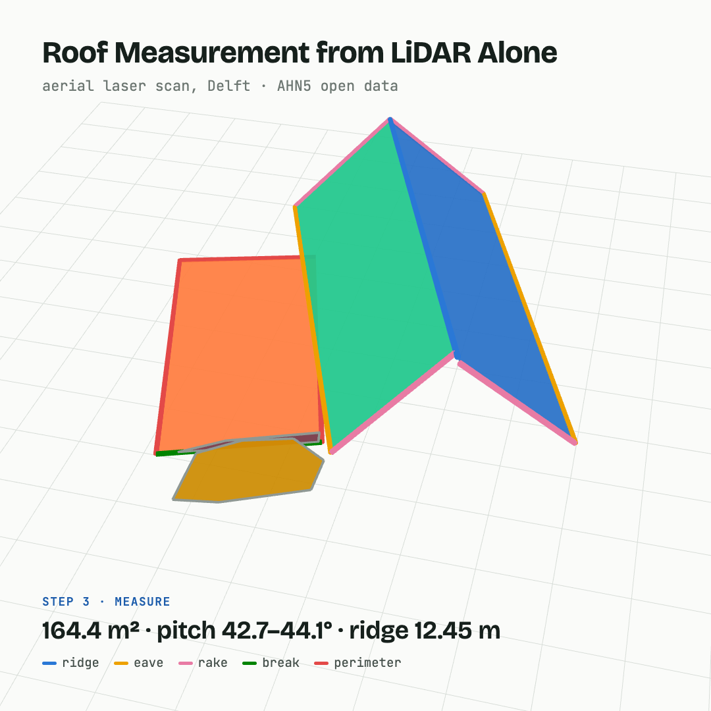

# Roof Measurement from LiDAR Alone

Measures a house's roof from an aerial laser scan and nothing else: no photos, plans or site
visit. Input is the point cloud of one house from the Dutch national scan (AHN). Output is
what a roofer measures by hand:

- every roof surface (facet) as a closed polygon, with its pitch, facing and true sloped area;
- every edge, typed as ridge, hip, valley, break, eave, rake or flat-roof perimeter, with its length;
- totals in m², ft² and roofing squares, with an error bar per facet;
- a 3D model (OBJ/PLY) built from the same numbers.

**Write-up, with figures and an interactive 3D model:** https://roof-measurement-lidar.netlify.app



The package is `roofrecon`. Python, numpy/scipy, Open3D and shapely; no cloud services and no
learned models.

## Results

Four detached houses in Delft (AHN5, 2023, about 30–50 points/m²). The footprint check
estimates roof area from the official building outline, the facets' pitches and the measured
eave overhang; it tests the report's consistency, not its correctness (see Validation below).

| house | roof | facets | roof area m² | ± p90 m² | footprint check |
|---|---|---|---|---|---|
| delft_03 | gable, flat extension, lean-to | 5 | 164.4 | 4.1 | +0.4% |
| delft_02 | two flat levels | 2 | 93.5 | 0.7 | +0.9% |
| delft_05 | hipped | 4 | 92.9 | 3.0 | +3.0% |
| delft_01 | mansard with a curved top | 8 | 224.2 | 6.0 | +4.3% |

On synthetic roofs with known answers (gable, hip, T-shaped, dormer; 20 random versions each),
facet area error by facet size:

| true facet area | facets | median \|error\| | 90th percentile |
|---|---|---|---|
| < 10 m² | 39 | 23.0% | 31.5% |
| 10–25 m² | 80 | 0.5% | 1.2% |
| ≥ 25 m² | 160 | 0.2% | 0.7% |

Small facets (dormers) are the weak spot, and the report marks them low confidence. Every
number, with its source and the settings it came from, is in [RESULTS.md](RESULTS.md).

## How it works

1. **Isolate.** Read the tile, keep building-class points, crop to the building outline plus a
   buffer sized by a sweep (the roof overhangs the walls), and recentre the coordinates.
2. **Planes.** Sequential RANSAC finds the roof planes, followed by a clean-up: reassign points
   to their nearest plane, merge coplanar planes, drop stray pieces, absorb leftovers. Region
   growing was compared and rejected; the settings come from sweeps over two reference houses
   and ten random seeds.
3. **Topology.** Internal edges are plane–plane intersections, and corners where three planes
   meet are exact. Each edge is typed by which way its two facets slope away from it. Outer
   edges come from each facet's traced outline, snapped to level (eave) or up-slope (rake).
   Facet polygons are closed from these lines.
4. **Report.** One JSON file per house: each physical edge listed once, true areas, rise per 12,
   squares, and a per-facet confidence from the synthetic error table above.
5. **Validate.** Footprint-based estimates (correctly averaged over mixed pitches, with the
   measured overhang) and a hand-measurement protocol for an independent check.

## Setup

```sh
uv sync         # Python 3.12 (Open3D has no wheels for newer versions yet)
uv run pytest   # 106 tests, mostly on synthetic roofs with known answers
```

## Usage

```sh
uv run python scripts/stage1_isolate.py --laz data/raw/<tile>.LAZ --bag-id <BAG pand id> --house-id <name> --crs EPSG:28992
uv run python scripts/stage2_segment.py --house-id <name> --method ransac   # planes, previews, normal map
uv run python scripts/stage3_topology.py --house-id <name>                 # facet polygons, typed edges
uv run python scripts/stage4_report.py --house-id <name>                   # report.json
uv run python scripts/export_model.py --house-id <name>                    # model.obj / .ply, edges, preview
uv run python scripts/view_model.py --house-id <name>                      # interactive 3D view over the points
uv run python scripts/stage5_validate.py                                   # footprint checks, hand measurements
```

Example output for one house: [docs/examples/](docs/examples/). The write-up is built with
`scripts/make_report_data.py` (figure data) and `scripts/build_site.py` (standalone page in `site/`).

## Repository layout

```
src/roofrecon/
  las_io.py       chunked LAZ reading with a bounding-box filter; header summary
  footprint.py    building outlines from the BAG (PDOK WFS) or OpenStreetMap; reprojection
  isolate.py      class filter, footprint crop, buffer sweep, recentering, density
  planes.py       plane fit, pitch, azimuth, areas, alpha shape
  normals.py      per-point normals by local PCA
  segment.py      sequential RANSAC, region growing, clean-up
  pipeline.py     stages 2-3 with the chosen settings
  topology.py     plane intersections, three-plane corners, edge typing
  polygons.py     facet polygons from internal and outer lines
  measure.py      the stage 4 report
  validate.py     footprint estimates, plan overlap, hand-measurement comparison
  export.py       the 3D roof model (mesh and edges)
  report.py       per-plane tables for stage 2
  viz.py          previews, normal map, PLY writing
scripts/
  stage1_isolate.py … stage5_validate.py   one script per stage
  stage2_sweep.py      parameter sweeps that chose the stage 2 settings
  scout_tiles.py       scores AHN sub-tiles around a place before downloading
  find_candidates.py   lists detached houses in a tile or bounding box
  export_model.py, view_model.py, view.py   3D model export and viewers
  make_report_data.py, build_site.py        the write-up
tests/            synthetic roofs with known answers, and tests per module
validation/       hand-measurement protocol and the measurements file
docs/             example output, sweep figures, the write-up
data/             not in git: raw/ for tiles, interim/ for per-house outputs
```

## Data

**Getting a tile.** GeoTiles (TU Delft) splits AHN into 1 × 1.25 km sub-tiles of a few hundred
MB, instead of the 4+ GB national sheets. Tile pages are at
`https://geotiles.citg.tudelft.nl/tiles/html/<TILE>.html`. Download the AHN5 (or AHN4) `.LAZ`
into `data/raw/`. `scripts/scout_tiles.py` helps choose a tile.

**Choosing houses.**

- **Detached, not terraced.** Most Dutch single-family homes are row houses whose roofs run
  continuously across party walls. The outline splits the building, but no geometric edge does,
  so facets would end at a wall that isn't in the points.
- Vary the roof types: gable, hip, and at least one with a dormer or an L-shaped plan.
- Avoid heavy tree cover over the roof. Points under the canopy are missing, not misplaced.

Houses are referred to by project labels (delft_01 …). Their BAG ids and addresses are kept out
of the repository, in the untracked `data/houses.csv`.

## Design notes

- **Class filter (6 = building).** The provider's classification is trusted, and its errors are
  measured: the class histogram inside the walls shows what isn't labelled building.
- **Buffer beyond the outline.** The BAG outline traces the walls; the roof extends 0.25–0.75 m
  past it on these houses. Crop at the walls and the eaves are cut off, which biases area low.
  The buffer sweep counts building points as the crop grows: the count rises to the eave, stays
  flat, then rises again at the next building. The buffer is chosen on the plateau.
- **Mitred buffer.** A round buffer cuts off square eave corners; mitred joins keep them.
- **Recentering.** float32, used by most PLY readers and GPUs, resolves only about 3 cm at Dutch
  map coordinates (y ≈ 450 000 m). Subtracting a whole-metre offset fixes that; the offset is
  stored so results can be mapped back.
- **Density in plan view, inside the walls.** Measured on the area the roof covers, so it isn't
  diluted by the empty part of the buffer (25.1 instead of 33.5 points/m² on delft_01).
  Nearest-neighbour spacing is reported separately.
- **Settings by sweep.** Each setting is swept over a range and the chosen value sits in the
  middle of the range that works, with the tradeoffs recorded in RESULTS.md.

## Limitations

- Facets under 10 m² (dormers, small lean-tos) have a median area error of about 23%.
- Four real houses from one tile; none has a valley or a dormer. The settings were chosen on two
  of them.
- Curved roofs are split into planar strips (delft_01's top).
- The footprint check tests consistency only. Hand measurements, the independent check, are in
  progress ([validation/PROTOCOL.md](validation/PROTOCOL.md)).

## Data sources and license

Laser points: [AHN](https://www.ahn.nl/) (Actueel Hoogtebestand Nederland), CC0. Building
outlines and construction years: [BAG](https://www.kadaster.nl/zakelijk/registraties/basisregistraties/bag)
via [PDOK](https://www.pdok.nl/), CC0.

Code: [MIT](LICENSE).
